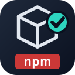

<p align="center">
  
</p>

<h1 align="center">NPM Publish Strict</h1>

<p align="center">
  An opinionated GitHub Action that releases an npm package with semantic-release and trusted publishing.
</p>

<p align="center">
  <a href="https://github.com/awalsh128/npm-publish-strict/releases"></a>
  <a href="https://github.com/awalsh128/npm-publish-strict/actions/workflows/release.yml?query=branch%3Amain"></a>
  <a href="https://github.com/awalsh128/npm-publish-strict/actions/workflows/ci.yml?query=branch%3Astaging"></a>
</p>

An opinionated GitHub Action that releases an npm package. It runs
[semantic-release](https://semantic-release.gitbook.io)
([Conventional Commits](https://www.conventionalcommits.org)), builds API docs with
[typedoc](https://typedoc.org), and publishes to npm with
[trusted publishing](https://docs.npmjs.com/trusted-publishers)
([OIDC](https://docs.github.com/en/actions/concepts/security/openid-connect), no token). When the repository
doesn't meet its preconditions, it stops before releasing and tells you exactly how to fix each one.

- 🏷️ Versions, tags and GitHub Releases come from Conventional Commits through semantic-release
- 🔐 Publishes to npm with trusted publishing, so the repository stores no token
- ✅ Checks the preconditions first and reports every failure at once, with the steps to fix each
- 🔎 `mode: check` verifies the setup, including the live npm trusted publisher exchange, without releasing
- 🛡️ [Provenance](https://docs.npmjs.com/generating-provenance-statements) on the package, and a build
  attestation on each release of this action

<!-- prettier-ignore -->
<p align="center">
  <a href="https://github.com/sponsors/awalsh128"></a>
</p>

<p align="center">
  Free and open source, and kept up by one person.<br />
  If it saves you time, <a href="https://github.com/sponsors/awalsh128">sponsor it monthly</a> or
  <a href="https://github.com/sponsors/awalsh128?frequency=one-time">leave a small one-time tip</a>. Every bit
  helps.
</p>

<!-- prettier-ignore -->
> [!IMPORTANT]
> The release job needs `contents: write` and `id-token: write`, full git history (`fetch-depth: 0`) and a
> public repository (npm only issues provenance for public repos).

## Quick Start

```yaml
# .github/workflows/release.yml
on:
  push:
    branches: [main, staging]
permissions: {}
jobs:
  release:
    runs-on: ubuntu-24.04
    permissions:
      contents: write # tags and GitHub Releases
      id-token: write # npm trusted publishing
      issues: write
      pull-requests: write
    steps:
      - uses: actions/checkout@<sha>
        with:
          fetch-depth: 0
          persist-credentials: false
      - uses: actions/setup-node@<sha>
        with:
          node-version: 24
          cache: npm
      - id: release
        uses: awalsh128/npm-publish-strict@c70700da8bf385050717a1749a938d39dbd3987d # v1.1.0
```

Configure the package's trusted publisher on npmjs.com for this workflow file (or run
`npm trust github <package> --file release.yml --repo <owner>/<repo>`).

## Requirements

- The release job needs `contents: write` and `id-token: write`, full git history and a public repository, as
  in the callout above.
- npm 11.5.1 or later on the release branch, and the package's trusted publisher set up on npmjs.com.
- Node 24 runtime (`runs.using: node24`).

## Configuration

### Inputs

| Input             | Required | Default        | Purpose                                                                                               |
| ----------------- | -------- | -------------- | ----------------------------------------------------------------------------------------------------- |
| `mode`            | no       | `release`      | `check` only verifies preconditions, from any branch                                                  |
| `bump`            | no       | `auto`         | Smallest bump to release (`patch`, `minor`, `major`); commits can raise it                            |
| `dry-run`         | no       | `false`        | `true` releases nothing: the checks run and semantic-release logs the version and notes it would make |
| `baseline-commit` | no       |                | Enforce and version only commits after this SHA                                                       |
| `github-token`    | no       | `github.token` | Token for the GitHub API and for pushing the release tag                                              |

The rest is convention, not configuration: the package is at the repository root, tags are `v${version}`,
`main` releases and `staging` cuts candidates, and `npm run docs:api` writes the docs to `docs/api`.

### Outputs

A later step or job can use them through the step's `id` (`steps.release.outputs.version`). Release outputs
are empty when nothing was released.

| Output          | Meaning                                                          |
| --------------- | ---------------------------------------------------------------- |
| `failed-checks` | Comma-separated ids of failed preconditions; empty when all pass |
| `released`      | `true` when a release was cut                                    |
| `version`       | Released version                                                 |
| `tag`           | Git tag (`v<version>`)                                           |
| `package-name`  | Name from the package's `package.json`                           |
| `prerelease`    | `true` for a release candidate, `false` for an official release  |
| `release-type`  | `major`, `minor` or `patch`                                      |
| `git-head`      | Commit SHA released                                              |
| `published`     | `true` when published to npm (official releases only)            |
| `npm-url`       | npm page of the published version                                |
| `release-url`   | GitHub Release URL                                               |
| `release-notes` | Markdown release notes                                           |

## Checks

Every run checks the repository's preconditions and reports all failures at once, with the steps to fix each.
The full list and the fix guidance are in [docs/preconditions.md](docs/preconditions.md). To verify a fix
without releasing anything, run the action with `mode: check`. It runs the same checks, including the live npm
trusted publisher exchange, and does nothing else.

```yaml
- uses: awalsh128/npm-publish-strict@c70700da8bf385050717a1749a938d39dbd3987d # v1.1.0
  with:
    mode: check
```

If your history predates Conventional Commits, set `baseline-commit`; see
[Adopting Conventional Commits](docs/adopting-conventional-commits.md).

## Supply chain: attestations

An [attestation](https://docs.github.com/en/actions/concepts/security/artifact-attestations) is a signed
statement of where and how an artifact was built, so you can check it came from the claimed repository and
commit.

- **Your package:** every npm publish from the release branch runs with provenance on
  (`NPM_CONFIG_PROVENANCE=true`), so npm attaches a signed [Sigstore](https://www.sigstore.dev) attestation
  linking the package to your repository, commit and workflow. Consumers verify with `npm audit signatures`.
  Publishing from a private repository is refused by a precondition, because npm can't issue provenance for
  it.
- **This action:** each release uploads `npm-publish-strict-<tag>.tar.gz` (the manifest, compiled `dist/`, and
  release config) with a GitHub build-provenance attestation. Verify the bytes you run:

  ```bash
  gh release download <tag> -R awalsh128/npm-publish-strict -p '*.tar.gz'
  gh attestation verify npm-publish-strict-<tag>.tar.gz -R awalsh128/npm-publish-strict
  ```

  Pin the action by commit SHA, as the examples do; the attestation covers the same tagged commit.

## ⚠️ Caveats

- If a tag ruleset blocks `github-token` from creating tags, set `GIT_CREDENTIALS` (`x-access-token:<token>`,
  for example from a GitHub App) in the step's `env`.
- Release outputs are empty when nothing was released.

Contributing: see [CONTRIBUTING.md](CONTRIBUTING.md).
